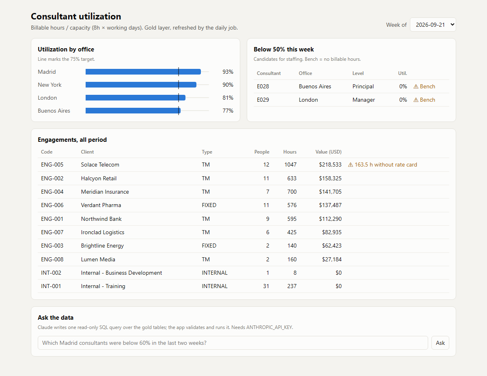
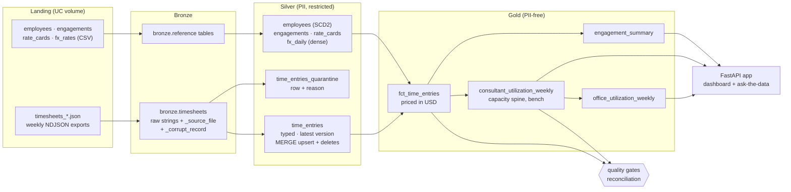

# Consultant utilization: a Databricks-style live-coding kit

A realistic **90-minute live-coding interview** for a Data Engineer role on a modern data
platform, packaged so you can practise it and then compare against a reference solution.

The scenario: a global consulting firm needs a **firm-wide utilization dataset** built from
messy weekly timesheet exports, so staffing managers can see who is on the bench and finance
can see the billable value of each engagement. The repo holds both halves of the exercise:

* **The exercise**: [INTERVIEW.md](INTERVIEW.md) (the brief, stages and time boxes),
  `starter/` (function signatures with TODOs) and a test suite that grades your attempt.
* **The reference solution**: PySpark + Delta Lake transforms (bronze -> silver -> gold),
  data-quality gates, a FastAPI app, Databricks Asset Bundles, Terraform for Unity Catalog,
  and GitHub Actions CI/CD.



## What it covers

| The job asks for | Where it is in this repo |
|---|---|
| Databricks pipelines and datasets | PySpark 4 + Delta: `src/utilization/transforms/`, Delta `MERGE`, Unity Catalog mode (`--catalog`) |
| Software engineering (git flow, CI/CD, PR reviews) | `.github/workflows/` (CI on PRs, OIDC deploy on `main`), PR template, CODEOWNERS, ADRs |
| Infrastructure as code | `databricks.yml` + `resources/` (job, app), `infra/terraform/` (schemas, volume, grants, warehouse) |
| Lightweight web applications | `app/`: FastAPI + vanilla JS dashboard, deployable as a Databricks App |
| Solid data engineering fundamentals | idempotency, SCD2 point-in-time joins, quarantine, reconciliation, schema drift, timezones |
| AI fluency | "Ask the data": Claude writes SQL, a sandbox runs only a validated `SELECT`. See also the follow-up questions |
| Data lifecycle management | layer-based access (PII only in silver), retention and `VACUUM`, `RESTORE` for rollback |

## Architecture



On Databricks it is one Asset Bundle job with four serverless tasks
(`bronze -> silver -> gold -> quality`) plus the app; Terraform provisions what they run on.

## Quick start

Requirements: [uv](https://docs.astral.sh/uv/), Java 17+ for Spark. On Windows, Spark needs
`winutils`, so run Spark commands in the dev container (Docker) instead.

```bash
uv sync --all-extras
uv run utilization run --stage all          # data/raw -> ./lakehouse (bronze/silver/gold)
uv run uvicorn dashboard.main:app --app-dir app --port 8000   # http://localhost:8000
```

Or everything in Docker:

```bash
docker compose up app                       # pipeline + dashboard on http://localhost:8000
docker compose run --rm dev pytest          # full test suite (46 tests, ~5 min)
```

`ANTHROPIC_API_KEY` in the environment enables "Ask the data"; everything else works without it.

## Practise the interview

1. Read [INTERVIEW.md](INTERVIEW.md). Set a 90-minute timer.
2. Explore the raw data (`data/raw/`, or `notebooks/01_explore.py`).
3. Implement `starter/transforms/bronze.py`, then `silver.py`, then `gold.py`.
4. Grade yourself stage by stage:

   ```bash
   uv run pytest --impl starter -k bronze
   docker compose run --rm dev pytest --impl starter -k silver   # Windows
   ```

5. Compare with `src/utilization/transforms/` and read
   [docs/solution-walkthrough.md](docs/solution-walkthrough.md).
6. Rehearse the answers in [docs/follow-up-questions.md](docs/follow-up-questions.md) out loud.

## Data model

| Layer | Table | Grain | Notes |
|---|---|---|---|
| bronze | `timesheets` | one row per line received | all strings, `_source_file`, `_ingested_at`, `_corrupt_record`; append-only, one load per file |
| bronze | `employees`, `engagements`, `rate_cards`, `fx_rates` | snapshot rows | overwritten each run |
| silver | `time_entries` | one row per `entry_id` | latest valid version; `MERGE` with version guard; tombstones delete |
| silver | `time_entries_quarantine` | one row per rejected version | `reason`, raw payload, idempotent insert |
| silver | `employees` | one row per employee version | SCD2, `[valid_from, valid_to)` |
| silver | `fx_daily` | currency x day | forward-filled, USD = 1.0 |
| gold | `fct_time_entries` | one row per non-rejected entry | level/office as of `work_date`, `billable_value_usd` |
| gold | `consultant_utilization_weekly` | employee x week | built from a capacity spine, so the bench is visible |
| gold | `office_utilization_weekly` | office x week | ratio of sums |
| gold | `engagement_summary` | engagement | hours, value, `unpriced_hours` |

## Data quality

Every bronze row ends up in silver or in quarantine with a reason (`malformed_json`,
`hours_out_of_range`, `unknown_engagement`, `unknown_employee`, ...). After gold, the
quality task checks key uniqueness, SCD2 overlaps, unmatched employees, missing FX, and
**reconciles gold hours to silver hours exactly**. Errors fail the job; warnings
(e.g. a missing rate card) are logged and shown in the app.

The test suite proves the properties that matter in production: re-running is a no-op,
and **week-by-week incremental runs produce exactly the same silver as a full replay**.

## Deploying to Databricks

```bash
cd infra/terraform
terraform init -backend-config=envs/prod.backend.hcl
terraform apply -var-file=envs/prod.tfvars       # schemas, landing volume, grants, warehouse

databricks bundle deploy -t dev                  # your own prefixed copy, schedule paused
databricks bundle run utilization_daily -t dev
```

CI validates all of it on every PR without a workspace (`terraform validate`, the bundle
checked against the CLI's JSON schema). The deploy workflow ships `main` to prod with GitHub
OIDC once the repository has a `DATABRICKS_HOST` variable. The workspace config has not
been run against a live Databricks workspace; it is validated statically.

## Repository layout

```
├── INTERVIEW.md                 the brief handed to the candidate
├── starter/transforms/          signatures + TODOs (your attempt)
├── src/utilization/
│   ├── transforms/              bronze.py · silver.py · gold.py (reference solution)
│   ├── lakehouse.py             local Delta paths or Unity Catalog tables
│   ├── pipeline.py · cli.py     orchestration and the job entry point
│   ├── quality.py               data-quality gates
│   └── datagen.py               deterministic synthetic data with planted defects
├── tests/                       one suite grades both implementations (--impl)
├── app/                         Databricks App: app.yaml + dashboard/ (FastAPI)
├── databricks.yml, resources/   Asset Bundle: wheel, job, app
├── infra/terraform/             Unity Catalog schemas, volume, grants, SQL warehouse
├── notebooks/01_explore.py      stage 0 exploration (Databricks notebook format)
├── docs/                        walkthrough, follow-up questions, ADRs
└── .github/                     CI, CD, PR template, CODEOWNERS
```

## Next steps

* Silver as a Lakeflow Declarative Pipeline (`APPLY CHANGES INTO ... SEQUENCE BY updated_at`)
  and bronze with Auto Loader, compared against this explicit version.
* Incremental gold with Change Data Feed and `replaceWhere` per `week_start`.
* Column mask on `email` and row filters by office in Unity Catalog.
* Write-audit-publish: build gold in a staging schema and swap only after the checks pass.

## License

MIT. All data is synthetic; company and person names are invented.
